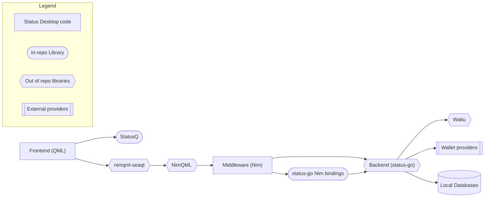
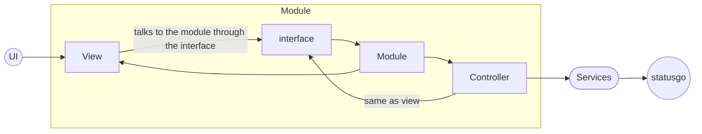
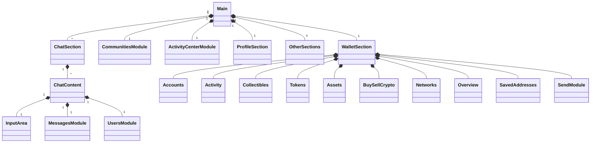

# Architecture of the Status App

## Architecture Decision Records (ADRs)

- [docs/adr/0001-android-status-go-as-a-service.md](/docs/adr/0001-android-status-go-as-a-service.md): Android architecture where `status-go` runs in a separate Service process and the UI talks to it via Binder IPC.

## Top level architecture

This shows the flow from the UI all the way to the backend.

We do not use servers. [status-go](https://github.com/status-im/status-go) is what our app considers the backend and as such, it has it's own local databases to contain the user data.

## Standard Nim module

This is the way how most of our Nim modules are assembled.

## Nim Middleware architecture

Shows how the Nim modules are connected. The Nim modules are more often than not associated with the UI view they represent.

### Local message reads

The shared Nim `ThreadPool.start` dispatcher also runs synchronous network RPCs.
Message pages (including thread history), pinned messages, reactions, message
lookups, search, thread lists/summaries, and first-unseen-message reads use
`ThreadPool.startLocalRead` instead. It owns a lazily started native worker with
a FIFO queue, so exhausted network workers cannot prevent local history from
loading. Completion delivery still uses the existing queued Qt signals.

Submit tasks from the GUI thread. Only local, read-only operations belong on
this worker; do not enqueue network requests or mutations that can sync with
peers. Teardown drains accepted reads and joins the worker before sweeping
typed completions. A second `taskpools.Taskpool` on the GUI thread is not an
equivalent implementation: taskpools uses a thread-local submitting-worker
context that would be replaced by the second pool.

The contacts service also coalesces concurrent profile-information requests by
public key. All callers share the existing keyed completion event; success or
failure releases the key so a later request can refresh or retry. This avoids
occupying multiple general workers waiting for the same store-node lookup.
