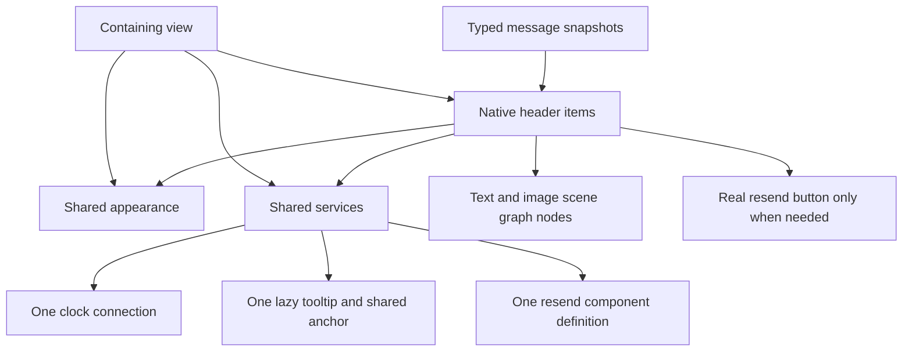

# Optimised message header components

Status: **experimental prototype**, used by Storybook and QML tests. Application
message rows still use `StatusMessageHeader.qml`. This document describes the
implemented architecture and measurements from 8 November 2026; it is not a
claim about whole-chat rendering performance.

## Components and responsibilities

| Component | Responsibility | Source |
|---|---|---|
| `StatusMessageHeaderPrototype` | Small QML entry point. Inherits the native item, declares accessibility, exposes timestamp aliases and forwards name clicks. | [QML](../ui/StatusQ/src/StatusQ/Components/StatusMessageHeaderPrototype.qml) |
| `MessageHeaderItem` | Owns message state, prepared content, text layouts, geometry, hit testing and scene graph output. Positions the optional resend control. | [Header](../ui/StatusQ/include/StatusQ/messageheaderitem.h), [implementation](../ui/StatusQ/src/messageheaderitem.cpp) |
| `MessageHeaderData` / QML `messageHeaderData` | Typed value containing one complete sender/message snapshot. Contains primitive values and strings, rather than a mutable sender QObject. | [Header](../ui/StatusQ/include/StatusQ/messageheaderdata.h) |
| `MessageHeaderAppearance` | Shared typed QObject containing fonts, colours, icon configuration, localized templates and time-format preferences. | [Header](../ui/StatusQ/include/StatusQ/messageheaderappearance.h), [implementation](../ui/StatusQ/src/messageheaderappearance.cpp) |
| `StatusMessageHeaderAppearance` | QML adapter that supplies theme values and translations to the native appearance object. Create once per view. | [QML](../ui/StatusQ/src/StatusQ/Components/StatusMessageHeaderAppearance.qml) |
| `MessageHeaderServices` | Shared runtime coordinator: clock subscriptions, tooltip ownership and creation of resend controls. Handles header registration and teardown. | [Header](../ui/StatusQ/include/StatusQ/messageheaderservices.h), [implementation](../ui/StatusQ/src/messageheaderservices.cpp) |
| `StatusMessageHeaderServices` | QML adapter containing one clock connection, one lazy tooltip and anchor, and one shared resend component definition. | [QML](../ui/StatusQ/src/StatusQ/Components/StatusMessageHeaderServices.qml) |

The [Storybook comparison page](../storybook/pages/StatusMessageHeaderPage.qml)
presents 19 legacy/native variants and counts their visual items. The
[test suite](../storybook/qmlTests/tests/tst_StatusMessageHeaderPrototype.qml)
covers data changes, rendering, interaction and lifecycle behaviour.



## Using the components

Create appearance and services at the view boundary and share them between
headers. Keep per-message values and interaction flags on each header.

```qml
import QtQuick
import StatusQ
import StatusQ.Components
import StatusQ.Core.Theme

Item {
    id: root

    property messageHeaderData message: ({
        senderId: "0x0123456789abcdef",
        displayName: "Alice",
        timestamp: Date.now(),
        isContact: true
    })

    StatusMessageHeaderAppearance {
        id: headerAppearance
        theme: root.Theme
    }

    StatusMessageHeaderServices {
        id: headerServices
    }

    StatusMessageHeaderPrototype {
        width: 600
        appearance: headerAppearance
        services: headerServices
        headerData: root.message
        showOutgoingStatusLabel: false
    }
}
```

`required services` in the prototype marks the **inherited** typed C++ property
as required; it does not declare another property. Omitting it causes component
creation to fail. See Qt's [required property documentation](https://doc.qt.io/qt-6/qtqml-syntax-objectattributes.html#required-properties).
The language construct checks initialization, not permanent non-nullness: use a
real view-owned service object, rather than explicitly assigning null.

`headerData` contains `senderId`, `displayName`, `secondaryName`,
`tertiaryDetail`, `messageOriginInfo`, `resendError`, `timestamp`,
`trustIndicator`, `outgoingStatus`, `isContact` and `amISender`. Timestamps are
epoch milliseconds. Trust and delivery codes match the existing components.
An unspecified `tertiaryDetail` falls back to `senderId`; the value type also
distinguishes an explicitly supplied empty detail.

Prepare a complete value off the header and assign it once. The gadget is not
language-enforced immutable, but publishing snapshots is the intended contract.
Updating `headerData` field by field, or rebuilding it separately for every
source notification, would reintroduce repeated publications. Equality checks
skip identical values, and deferred polish consumes the latest inputs, but this
does not make arbitrary caller-side changes transactional.

`displayNameClickable`, `showFullTimestamp`, `showOutgoingStatusLabel` and
`isMobile` remain independent per-header properties. They are not shared
appearance state. The public interaction signals are `clicked(sender)` and
`resendClicked()`; the prototype forwards the native item as the click anchor.

## Performance optimisations in the implementation

### 1. One native visual item for ordinary headers

Text and icons are rendered directly using `QTextLayout`, `QSGTextNode` and
image nodes. There are no QML Text objects, layouts or loaders for each piece
of metadata. The native renderer is also the QML component root, removing an
outer item and its geometry bindings.

This primarily reduces creation work, QObject count, bindings and memory.
Qt still performs shaping and rendering; the implementation does not replace
Qt's font engine or render text into a custom bitmap cache.

### 2. Typed, atomic message data

`MessageHeaderData` is a registered Q_GADGET value with typed properties and
value equality. The message input is one `headerData` property, with no legacy
untyped compatibility path. The renderer does not repeatedly read fields from
a mutable sender object or decode a JavaScript content map.

One publication invokes one setter. Related values are prepared together,
and identical snapshots do not schedule another update. Qt's implicitly shared
strings make value copies cheaper than duplicating their character buffers.

### 3. Shared typed appearance

Fonts, colours, translated strings, asset URLs and time-format preferences are
bound once per view. Headers hold a pointer to the typed appearance object.
This replaces per-header presentation objects, arrays, QJSValue conversion and
many theme/translation bindings.

The QML adapter supplies translations using the existing translation contexts.
The native class has an English fallback for missing/destroyed appearance
objects; application views should provide the themed, translated adapter.

### 4. Typed prepared content instead of a rendering map

The internal `PreparedHeader` struct stores the strings, URLs and flags used
by layout. Rendering and accessibility read these fields directly, avoiding
string-key lookups and QVariant conversions on each update.

The public `displayData` map is a diagnostic view assembled only when read.
It is not the internal rendering representation.

### 5. Separate invalidation paths and conditional notifications

Content, status, cached-part updates, geometry and clock changes are tracked
separately and coalesced through polish. For example:

- Width/height changes update wrapping and positions without preparing content.
- Colour changes update cached parts without timestamp formatting or geometry.
- Status-label toggles prepare only status data; incoming headers can skip work
  when that flag cannot affect their output.
- Timestamp checks on data assignment are needed only when the timestamp changes.
- Name hover skips content preparation and the other parts' text-update pass;
  their cached geometry is still used.

`displayDataChanged`, `accessibleTextChanged` and `layoutChanged` are emitted
when their corresponding values change. Colour or hover changes do not
unnecessarily rebuild accessible text. Qt's implicit-size change detection is
retained.

### 6. Retained text layouts and measurements

Each active part retains its layout while text and font remain unchanged.
Tail pieces are measured before calculating the name's available width. Name
layout also checks the available width, preserving wrapping on resize.

This is per-header reuse, not a shared shaped-text cache. Name measurement
still uses `QFontMetricsF::horizontalAdvance()` as well as layout, and changing
underline on hover still rebuilds the name layout. Those costs remain.

### 7. Active parts matched by semantic role

Optional icons, secondary names and origin information can move an unchanged
timestamp or separator to another vector position. Parts now carry semantic
keys, so a short search finds and reorders an existing active part instead of
treating the new position as a different label.

The search is bounded by eleven possible keys. Unchanged ordering takes a fast
path. Inactive parts are deleted; there is no map or persistent cache of hidden
variants. A header-wide monotonic revision counter keeps render-node reuse
correct when parts move or are removed/recreated between rendered frames.

This was retained for its targeted metadata-update benefit. It is not a
material improvement to general creation or full-message rebind.

### 8. Native timestamp formatting and per-header caching

Formatting runs in C++ and caches the timestamp, formatting preferences, locale,
language, translated templates, calendar day, timezone and UTC offset. A clock
check does not reformat an unchanged value. Full tooltip text is formatted on
demand rather than bound eagerly on every header.

Clock dispatch is shared through the services object, with a registry of
windowed, visible headers that have a nonzero timestamp and use relative time.
There is no per-header QML `Connections` object. Visibility here is effective
item visibility, not viewport-intersection testing.

The existing one-second timer cadence is unchanged. Date/locale/timezone checks
and environment caches are still per-header; scheduling only relevant calendar
changes or sharing that environment has not been implemented.

### 9. One lazy tooltip per view

Native hit testing identifies timestamp and verification regions, so a second
per-header tooltip hover handler is unnecessary. Services lazily create one
styled tooltip and reuse it across headers. One shared anchor preserves the
former text-area positioning, including taller allocated headers and space
reserved for Resend.

Tooltip requests wait until pending data preparation finishes. Rebinding,
hiding, disabling, window changes and destruction dismiss or refresh the
target safely. This prevents old message text from appearing after row reuse.

### 10. Real resend controls created only when needed

The service holds one QML component definition. A header creates a real
`StatusButton` instance when the existing resend visibility rule requires it,
without keeping a loader on every ordinary header. Keyboard, pointer,
accessibility and styling behaviour remain provided by the control.

Creation happens on the data/flag change path. QObject and visual parents are
set before the required header input and component completion, avoiding late
font/theme inheritance and extra layout work. When removed, the button is
immediately hidden and disabled, then deleted later. Buttons are not pooled.

### 11. Shared icon raster data and retained scene graph state

A bounded image cache, approximately 1 MiB, keys icon rasters by URL, size,
device-pixel ratio and tint. It avoids repeated SVG reads/rasterisation and
shares QImage data between headers. Textures remain owned by their individual
render nodes; this is not a shared GPU texture cache.

Scene graph children are retained when revision and position match. Persistent
grouping nodes are transform nodes so the software renderer preserves inherited
position and clipping when a text subtree is replaced. This is also a
correctness requirement for updates inside a scrolled or translated parent.
Position changes still rebuild children, and icon rebuilds still create
textures; more complete in-place node updates remain possible.

### 12. Direct inherited properties and aliases

The thin QML wrapper inherits native inputs directly, eliminating duplicate
QML properties and relay bindings. Its timestamp convenience properties are
readonly aliases. The earlier alias experiment produced only small CPU
differences, so aliases are a small supporting improvement rather than the
main source of the overall gain.

## Measured performance

The following are **two separate measurement snapshots**. The legacy comparison
was made immediately before semantic-part caching was added. The incremental
comparison measures that last change against the preceding native version.
Do not multiply their percentages or present them as one paired experiment.

### Legacy comparison, before the final semantic-part change

CPU milliseconds per batch of 256 headers; memory is incremental KiB per header.

| Metric | Common: legacy → native | Rare: legacy → native |
|---|---:|---:|
| Creation | 99.518 → 10.029 | 114.632 → 23.637 |
| Full rebind | 17.089 → 6.908 | 71.955 → 18.956 |
| Memory | 148.855 → 24.914 | 164.340 → 50.473 |

This measured approximately 9.9×/4.8× faster creation, 2.5×/3.8× faster full
rebind and 83%/69% lower component memory for the two groups.

An ordinary incoming variant used 21 QQuickItems and 57–58 QObjects in legacy,
versus one QQuickItem and two QObjects in the isolated native component. An
expired/resend variant used 34 versus 16 QQuickItems. Counts exclude shared
objects and scene graph nodes; embedding a header in a QML Layout introduces
additional attached objects.

After visiting timestamp tooltips on 128 incoming headers and hiding them,
retained PSS increased by 12.94 MiB for legacy and 4.27 MiB for native. This
includes window/render/cache and first-popup setup, not just popup allocations.
Clock dispatch/check work for 256 visible headers measured 2.821 versus
0.660 ms per tick. Neither figure is a whole-application idle CPU measurement.

### Latest incremental result: semantic-part reuse

| Operation | Previous native → current native |
|---|---:|
| Common creation, ms/256 | 9.993 → 10.236 |
| Rare creation, ms/256 | 23.386 → 23.343 |
| Common full rebind, ms/256 | 6.788 → 6.850 |
| Rare full rebind, ms/256 | 19.297 → 18.952 |
| Metadata-only update, ms/256 | 3.734 → 1.704 |

A metadata-only update keeps the sender name and timestamp fixed while rotating
contact/trust icons, secondary name and origin information. It measured 54%
less CPU work. General creation/full-rebind differences were small and mixed;
there is no claim of a broad speedup from this last change.

After eight full rebinds, incremental PSS was 25.469 → 25.523 KiB/header for
common cases and 76.346 → 76.395 for rare cases: about 50–56 extra bytes per
header. The larger rare-case increase after repeated reuse occurred in both
versions and is not resolved by semantic-part caching.

### Measurement protocol and limits

- Qt 6.11.0 Release on Linux, offscreen software backend, 600 px header width.
- Common: 227 synthetic incoming fixtures with varying names, timestamps and
  contact flags. Rare: ten equally weighted delivery, trust, secondary-name,
  origin and resend fixtures. These are not production-frequency estimates.
- Inputs were prepared outside timing: sender objects and primitive properties
  for legacy; typed snapshots for native. Shared style/services were also
  outside the per-header memory delta.
- CPU measurements included binding work and Qt's actual window polish queue,
  excluding frame scheduling and rendering. A benchmark-only private-Qt probe
  flushed the same queue for both implementations. Earlier native-only tests
  that called `ensurePolished()` directly are not numerically interchangeable.
- Timing used forward/reverse ABBA process order, two warmup and eleven measured
  rounds per process; the tables contain medians.
- Memory used 2048 invisible headers, warmed caches, GC/allocator trimming and
  three fresh processes per version/group. GPU memory is excluded.
- The focused metadata test used seven variants and averaged six transitions
  per sample. It does not model the frequency of metadata changes in the app.
- Names, timestamp strings and final heights matched for the comparison fixtures
  at 600 px. Near wrap thresholds, legacy's per-label rounding and native's
  fractional measurements can produce different wrapping. This is not a
  pixel-equivalence audit at every width or locale.

Exploratory run identifiers were `header-legacy-comparison-20261108` and
`header-role-cache-20261108`. Their scratch harnesses, raw samples and logs were
written under `/tmp`; those files are not durable project benchmark targets.
The tables and protocol above preserve the relevant results independently.

## Validation and remaining work

The latest implementation has 89 passing QML test results on both software and
OpenGL renderers, including data-driven rows. Coverage includes
timestamp parity, wrapping, atomic publications, name clicks, accessible text,
shared appearance updates, tooltip delays/target changes, service/header
destruction, window changes, resend sizing and mouse/keyboard activation.

Optional-part transitions are compared with fresh headers at widths 240, 480
and 600. Equal-metrics text replacement and removal/recreation before an
intervening frame check render revision correctness. Screenshot comparisons
show only one header at a time at the same scene position: QtTest's
`grabImage()` captures a window crop, so overlapping reference items would
invalidate the comparison.

For the existing local Qt 6.11 Release build:

```sh
cmake --build storybook/build/Desktop_Qt_6_11_0-Release --target Storybook QmlTests -j4
QT_QPA_PLATFORM=offscreen QT_QUICK_BACKEND=software \
  storybook/build/Desktop_Qt_6_11_0-Release/bin/QmlTests \
  -input storybook/qmlTests/tests/tst_StatusMessageHeaderPrototype.qml
```

Before application integration, validate real delegate reuse and production
message distributions, investigate wrap-boundary parity and repeated-rebind
memory growth, and profile actual hardware frame time/GPU memory. Minimal-input
parity also needs attention: native preparation currently produces an ellipsis
for an empty tertiary detail, where legacy suppresses that detail label. The
performance comparison fixtures avoid that discrepancy. Shared shaped
text, paint-only name underline, in-place scene graph updates, shared timestamp
environment/scheduling and resend-button pooling remain potential improvements;
they are not part of the measured implementation described here.
